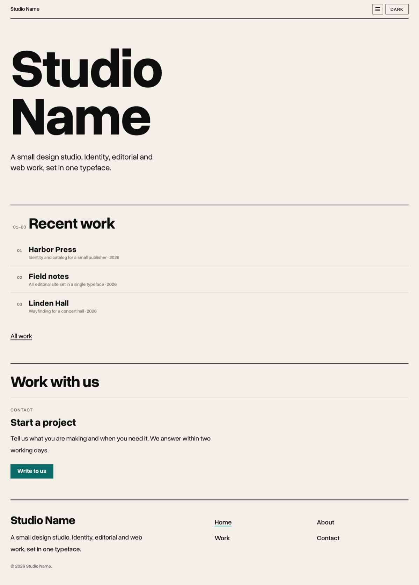

This site says, right on the home page, that Swiss Minimal is a design kit your AI agent can implement. I work with the kit every day, but always with its repository open beside me. I had never tried it the way a visitor would: paste the prompt from the [Agents](/agents/) page into an empty folder and walk away. So I decided to kick the tires on my own claim.

Here is what I ran, what came back, and where the kit's instructions let the agent down.

## The recipe

- **The prompt:** the one on the Agents page, word for word. It asks for a new Astro site with Home, Work, About and Contact pages in the azure accent, and an `AGENTS.md` for the site.
- **The agent:** Claude Code, on the Claude Fable 5.2 model, started fresh with no knowledge of the kit or of my own projects.
- **The folder:** empty.
- **The kit:** version 2026.1115.3 from npm.
- **The date:** November 15, 2026.

I added three things to the prompt that a visitor would not need to: which folder to work in, where Node 24 lives on my machine, and a request to report honestly at the end, problems included. Note that results like these change with the model, the kit's version and the day, so read the numbers as one run, not a benchmark.

## What it built

Four pages, all on the kit's `BaseLayout`, with the menu, the footer and the azure accent set once. The home page has a hero, three list rows and one call to action. Work is a dark page title over rows grouped by year. About is prose and a summary list, and Contact is a form.

It also wrote the site's `AGENTS.md`, pointing at the six docs that ship inside the npm package, and copied the accessibility tests from the kit's `TOOLING.md`.

All of the content is invented. The prompt gave it no name, no copy and no pictures, so the site is called "Studio Name" and has no images at all. I think that was the right call, since the kit's rules say not to add filler.

## The numbers

- **Time:** 5 minutes and 28 seconds, from the prompt to its report.
- **Tool calls:** 32, mostly shell commands and file reads.
- **Tokens:** the app reported 149,544 for the run, of which about 25,000 were written by the agent.
- **Build:** `npm run build` passes, four pages.
- **Type check:** `npx astro check` passes with no errors, warnings or hints.
- **Rules:** I searched the source for colors outside the kit's tokens, shadows, rounded corners and inline styles, and found none.

I ran the build and the type check again myself afterward, and both passed.

## What went wrong

This is the useful part, so I'll list it plainly.

- **The tests did not run as written.** They need a browser that Playwright downloads, and the agent would not download one outside its folder. It ran them once against the Chrome already on my machine, where all 12 passed, but `npm test` on its own still fails until that browser is installed.
- **The kit's test setup broke the type check.** Copying the Playwright config from `TOOLING.md` gave four type errors on a new site, because the install line left out `@types/node`. The agent worked it out and added the package.
- **It had to go to GitHub for the list rows.** The kit describes a list row and a section header in prose, with no component and no markup to copy. The agent fetched the demo's own `Row` and `Section` files to get them right. Those files are not in the npm package.
- **The instructions skip the first step.** They say to make an Astro project with Tailwind, and not how. They also say to look for an `.nvmrc`, which a new site doesn't have.
- **One stale word.** `DESIGN.md` still called the azure accent by its old name in one place.
- **Nothing was checked by eye in a real browser.** The agent looked at screenshots of the built pages at two widths, mostly in light mode. It did not test the keyboard, focus rings or the theme toggle.
- **The contact form opens the mail program.** With no backend named in the prompt, it used a `mailto:` address, so there is no confirmation after sending.

I have already fixed the stale word and the install line. The rest are on my list.

## Summary

And there you have it: a four-page site that builds, passes the type check and follows the rules, in about five and a half minutes from one prompt. I would venture to say that backs up the claim on the home page, with a caveat. The agent got there partly by reading the demo's source on GitHub, which tells me the kit's own docs still have gaps, and it left the testing half done.

Of course this was one run with one agent, and I have not tried other tools or models yet. I did the same for Verdigris, the kit built on this one, and [wrote that run up too](https://www.verdigris.ch/blog/an-agent-built-this/).

## Resources

- [Agents](/agents/), where the prompt lives
- [USING.md](https://github.com/danny-englander/agentic-design-kits/blob/main/USING.md), the steps the agent followed
- [TOOLING.md](https://github.com/danny-englander/agentic-design-kits/blob/main/TOOLING.md), the tests it copied
