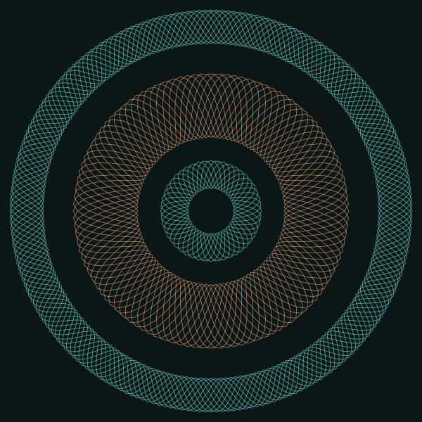

<p align="center">
  
</p>

<p align="center"><a href="https://verdigris.ch">verdigris.ch</a></p>

# Verdigris Design Kit

A design kit your AI agent can implement, for Astro and Tailwind v4: Swiss Minimal's strict grid, set in Cormorant, in verdigris and copper, with ornament that earns its place. No capitals anywhere, for accessibility.

It is built on [Swiss Minimal](../README.md) and lives in a folder of its repository. See [Built on Swiss Minimal](#built-on-swiss-minimal).

It is on npm:

```bash
npm install @agentic-design-kits/verdigris
```

```css
@import "@agentic-design-kits/verdigris/tailwind.css";
```

Swiss Minimal comes with it. To update, run `npm update`. Versions follow the release date: `2026.1113.0` is the first release on 13 November 2026.

- [`DESIGN.md`](DESIGN.md): the rules (color, type, layout, images, motion, accessibility, Tailwind setup).
- [`COMPONENTS.md`](COMPONENTS.md): markup and rules for each component.
- [`TOOLING.md`](../TOOLING.md) (Swiss Minimal's, for both kits): recipes for accessibility tests (Playwright and axe) and date-tagged releases, and a manual checklist.
- [`AGENTS.md`](AGENTS.md): notes for AI agents (also `CLAUDE.md`): working on this repository, starting a new site with the kit, and restyling an existing one.
- [`kit/`](kit): what makes this Verdigris: `tailwind.css`, `verdigris.css`, `fonts.css` and the components written here (`BaseLayout`, `Mark`, `Rosette`). `kit/shared/` passes on Swiss Minimal's components and scripts, so a site imports all of them from `@agentic-design-kits/verdigris`.
- [`fonts/`](fonts): Cormorant (SIL OFL 1.1). Source Code Pro, for code, comes with Swiss Minimal.
- [`demo/`](demo): a small Astro site that uses every component. It installs the kit as the `@agentic-design-kits/verdigris` package, through the npm workspace in the repository's root [`package.json`](../package.json).

## Run the demo

Needs Node 24 or later (`demo/.nvmrc` pins 24).

```bash
cd demo
nvm use
npm install
npm run dev
```

## Test the demo

Builds the demo and scans every page, the menu tabs and the drawer for WCAG 2.1 AA problems in light and dark. See [`TOOLING.md`](../TOOLING.md).

```bash
cd demo
npx playwright install chromium
npm test
```

## Built on Swiss Minimal

The base stylesheet, the scripts and most components are Swiss Minimal's. Verdigris uses them as the `@agentic-design-kits/swiss-minimal` package and adds its own look on top. Both kits are in this repository, Swiss Minimal at the root and Verdigris in `verdigris/`, so Verdigris always uses the Swiss Minimal beside it.

- **The Verdigris look** lives in `kit/verdigris.css` and `kit/fonts.css`. Change those here.
- **A fix to a shared component** goes in Swiss Minimal's [`kit/`](../kit), and both demos have it at once.
- **When Swiss Minimal adds or removes a component or script,** run this at the repository's root, so Verdigris passes it on:

  ```bash
  npm run shared
  ```

The full rules are in "Verdigris is built on Swiss Minimal" in [`AGENTS.md`](AGENTS.md).

## Releases

Verdigris is released together with Swiss Minimal, by `npm run release` at the repository's root. See Releases in the root [`README`](../README.md). Before releasing something a visitor would notice, add it at the top of `demo/src/data/features.ts`.

## License

MIT: see [`LICENSE`](../LICENSE). The fonts in [`fonts/`](fonts) keep their own license, SIL OFL 1.1.
