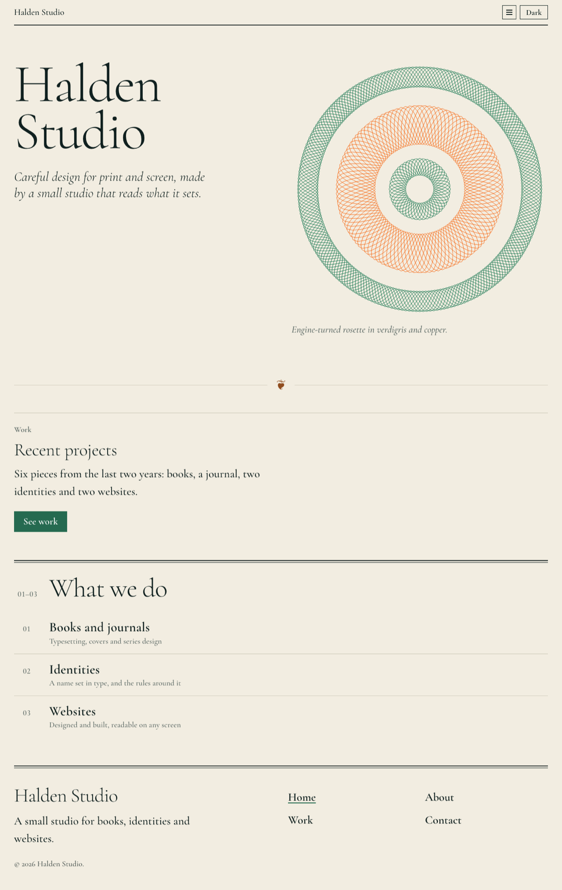

This site says, right on the home page, that Verdigris is a design kit your AI agent can implement. The fair test of that claim is to use the kit the way a visitor would: paste the prompt from the [Agents](/agents/) page into an empty folder and walk away. The same test had just been run on Swiss Minimal, the kit this one is built on, so this run repeats it here.

Here is what went in, what came back, and where the kit's instructions let the agent down.

## The recipe

- **The prompt:** the one on the Agents page, word for word. It asks for a new Astro site with Home, Work, About and Contact pages, and an `AGENTS.md` for the site.
- **The agent:** Claude Code, on the Claude Fable 5.2 model, started fresh with no knowledge of the kit or of any other project.
- **The folder:** empty.
- **The kit:** version 2026.1115.3 from npm, which brings Swiss Minimal with it.
- **The date:** November 15, 2026.

The prompt had three additions a visitor would not need: which folder to work in, where Node 24 is installed, and a request to report honestly at the end, problems included. Results like these change with the model, the kit's version and the day, so read the numbers as one run, not a benchmark.

## What it built

Four pages, all on the kit's `BaseLayout`, with the menu and the footer. The home page opens with the name beside the kit's rosette, then a fleuron rule, one call to action and three list rows. Work is a page title over two sections of rows. About is prose, one plate and a summary list, and Contact is a form.

It also wrote the site's `AGENTS.md`, pointing at the kit's docs inside the npm package, and copied the accessibility tests from `TOOLING.md`, with one more that checks nothing on a page renders in capitals.

All of the content is invented. The prompt gave it no name, no copy and no pictures, so the site is called "Halden Studio" and its only image is the rosette. It used ornament sparingly, one rosette and one fleuron on the home page, which is what the rules ask for.

## The numbers

- **Time:** 5 minutes and 39 seconds, from the prompt to its report.
- **Tool calls:** 29, mostly shell commands and file reads.
- **Tokens:** the app reported 154,149 for the run, of which about 24,500 were written by the agent.
- **Build:** `npm run build` passes, four pages.
- **Type check:** `npx astro check` passes with no errors, warnings or hints.
- **Tests:** 12 pass, with a caveat covered below.
- **Rules:** a search of the source for colors outside the kit's tokens, shadows, rounded corners, capitals and inline styles found none.

The build and the type check were run again afterward, outside the agent, and both passed. That is within a few seconds of the Swiss Minimal run, which took 5 minutes and 28 seconds.

## What went wrong

This is the useful part, so here it is plainly.

- **The prompt asked for something the kit doesn't have.** It ended with "Accent: verdigris", but Verdigris has one palette and nothing to set. The agent noticed, passed no accent, and said so. That line is gone from the prompt now.
- **The tests needed a workaround.** They want a browser that Playwright downloads, and the agent would not download one outside its folder. It pinned Playwright to an older version whose browser was already installed on the machine. All 12 tests then passed, but on another computer `npm test` needs that download first.
- **It had to go to GitHub for the list rows and the hero.** The kit describes a list row in prose, with no component to import, and the `Hero` component only takes an image file, so a hero with the rosette is hand-written markup. The agent copied both from the demo's source, which is not in the npm package.
- **Two docs disagreed.** One said the rosette turns once in two minutes, another said 30 seconds. The stylesheet says 30, and the first doc is corrected now.
- **The shared docs speak for Swiss Minimal.** The component notes quote its sizes, and the manual checklist has a line about an accent that Verdigris doesn't have.
- **Nothing was checked by eye in a real browser.** The agent looked at four of its twelve screenshots. It did not test the keyboard, focus rings or the theme toggle.
- **The contact form opens the mail program.** With no backend named in the prompt, it used a `mailto:` address, so there is no confirmation after sending.

The prompt and the rosette's speed are fixed now. The rest are still open.

## Summary

The result is a four-page site in Cormorant and copper green that builds, passes the type check and its own tests, and follows the rules, in a little over five and a half minutes from one prompt. That backs up the claim on the home page, with a caveat. The agent leaned on the demo's source for two things the docs should have given it, and the most useful finding was a mistake in the prompt itself.

This was one run with one agent; other tools and models are still untested.

## Resources

- [Agents](/agents/), where the prompt lives
- [USING.md](https://github.com/danny-englander/agentic-design-kits/blob/main/verdigris/USING.md), the steps the agent followed
- [TOOLING.md](https://github.com/danny-englander/agentic-design-kits/blob/main/TOOLING.md), the tests it copied
- [The Swiss Minimal run](https://www.swissminimal.ch/blog/an-agent-built-this/), the same test on the kit this one is built on
