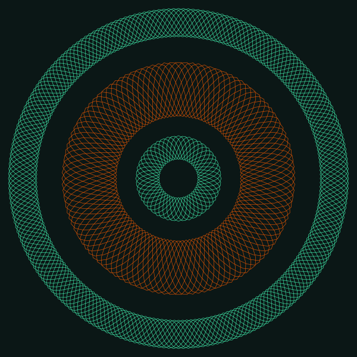

[](https://www.verdigris.ch)

[verdigris.ch](https://www.verdigris.ch)

# Verdigris Design Kit

A design kit your AI agent can implement, for Astro and Tailwind v4: Swiss Minimal's strict grid, set in Cormorant, in verdigris and copper, with ornament that earns its place. No capitals anywhere, for accessibility.

It is not a library of components to copy and paste. It is a set of rules, and an agent that follows them: what each color is for, which weights to use, where a rule goes, and when not to add anything at all. Say what the site should do, and a coding agent picks the components, writes the code and checks it against the rules. See [Agents](https://www.verdigris.ch/agents/) on the demo site.

Verdigris is one of the [Agentic Design Kits](https://github.com/danny-englander/agentic-design-kits). It is built on [Swiss Minimal](https://www.npmjs.com/package/@agentic-design-kits/swiss-minimal), which is installed with it.

## Install

```bash
npm install @agentic-design-kits/verdigris
```

```css
@import "@agentic-design-kits/verdigris/tailwind.css";
```

That one import, at the top of the site's global stylesheet, loads Tailwind, Swiss Minimal and the Verdigris look. Components, types and scripts are imported by name, all from this package:

```astro
---
import BaseLayout from '@agentic-design-kits/verdigris/astro/BaseLayout.astro';
import Hero from '@agentic-design-kits/verdigris/astro/Hero.astro';
import type { MenuItem } from '@agentic-design-kits/verdigris/types';
---
```

To update, run `npm update`. Versions follow the release date: `2026.1113.0` is the first release on 13 November 2026, and `2026.1113.1` a second that day.

## In the package

- `USING.md`: the steps for starting a new site with the kit, and for restyling an existing one. Agents start here.
- `llms.txt`: an index of the files below for AI agents, with one line on what each is for.
- `DESIGN.md`: the rules (color, type, layout, images, motion, accessibility, the Tailwind setup) and a "Do not" list. Read it first.
- `COMPONENTS.md`: the markup, behavior and do's and don'ts for each component.
- `tokens.json`: every token value, light and dark.
- `kit/`: what makes this Verdigris: `tailwind.css`, `verdigris.css`, `fonts.css` and the components written here (`BaseLayout`, `Mark`, `Rosette`). `kit/shared/` passes on Swiss Minimal's components and scripts.
- `fonts/`: Cormorant. Source Code Pro, for code, comes with Swiss Minimal.

Recipes for accessibility tests (Playwright and axe) and a manual checklist are in Swiss Minimal's `TOOLING.md`, at `node_modules/@agentic-design-kits/swiss-minimal/TOOLING.md`.

## For AI agents

Read `USING.md` in this package (`node_modules/@agentic-design-kits/verdigris/USING.md`): it covers starting a new site with the kit and restyling an existing one, step by step, and names the other files to read. The same file is [on GitHub](https://github.com/danny-englander/agentic-design-kits/blob/main/verdigris/USING.md), for reading before the kit is installed. The demo site's [Agents](https://www.verdigris.ch/agents/) page has prompts to start from.

The kit is also an agent skill, so an agent picks it up when a task calls for it, with no pointer to the docs in the prompt:

```bash
npx skills add danny-englander/agentic-design-kits --skill verdigris
```

The skill holds no rules of its own. It sends the agent to the files in this package, so it never falls behind the version that is installed.

## License

MIT. The fonts keep their own license, SIL OFL 1.1; each license file is beside its font in `fonts/`.
